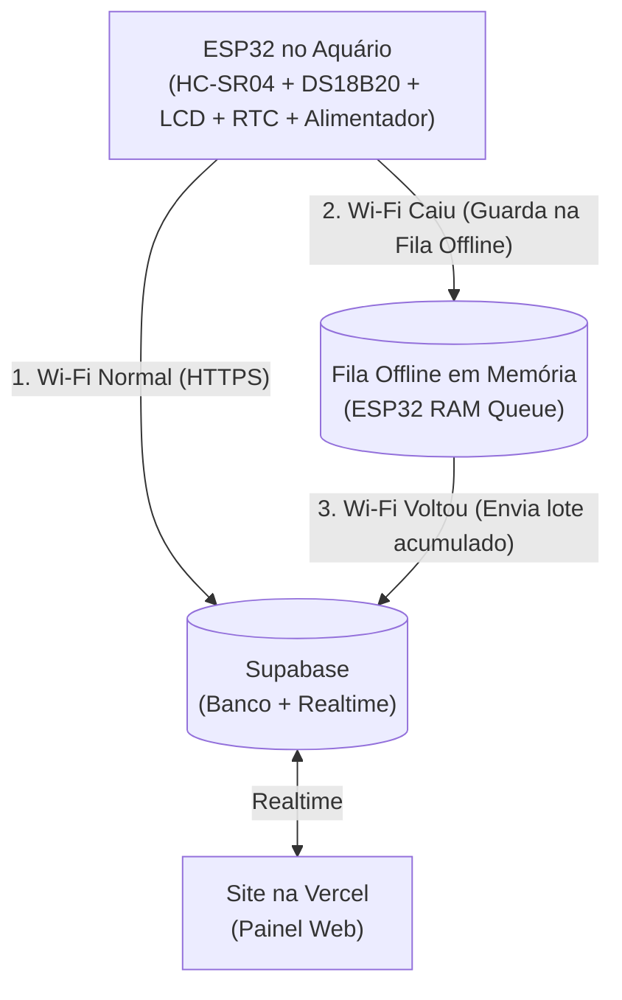

# Documentação de Arquitetura & Planejamento — Projeto NETUNO

Este documento registra todas as decisões de arquitetura, fluxos de comunicação (Online e Offline) e especificações técnicas definidas para o ecossistema do aquário inteligente **Netuno**.

---

## 1. Visão Geral dos 3 Pilares do Sistema

| Componente | Tecnologia | Papel no Ecossistema |
| :--- | :--- | :--- |
| **1. Hardware (No Aquário)** | **ESP32** (`C++ / Arduino`) | Lê o sensor ultrassônico (`HC-SR04`) e temperatura (`DS18B20`), controla o display LCD `16x2`, sincroniza horários via módulo RTC, controla a bomba de oxigênio e aciona o alimentador automático via **Wi-Fi**. |
| **2. Nuvem & Tempo Real** | **Supabase** (`PostgreSQL + Realtime`) | Armazena o estado atual do aquário (`aquarium_status`), os horários de alimentação (`feed_schedules`) e o histórico de leituras/eventos (`telemetry_logs`). Sincroniza o Painel Web em tempo real. |
| **3. Painel Web** | **React + Vite + Tailwind CSS** (Hospedado na **Vercel**) | Interface web completa para monitoramento e controle pelo computador ou navegador. |

---

## 2. Identidade Visual & Paleta de Cores ("Oceano Profundo")

Inspirada na logo oficial do **Netuno** (carpas em estilo xilogravura/porcelana sobre fundo azul cobalto):

* **Azul Cobalto Oficial (Cor da Logo):** `#1A539B`
* **Fundo Oceano Profundo (Background Principal):** `#06101E`
* **Fundo de Cards / Superfícies (`Abyss`):** `#0B1D35` e `#0F2747`
* **Destaques Luminosos / Água (`Cyan`):** `#38BDF8`
* **Tipografia Principal:** `Cinzel` (títulos clássicos serifados), `Inter` (interface) e `JetBrains Mono` (dados técnicos e telemetria).

---

## 3. Como Funciona a Comunicação em Cada Cenário



### Cenário A: Tudo Normal (Wi-Fi do Aquário Funcionando)
1. O **ESP32** mede o nível da água e a temperatura a cada ciclo, envia o status atual para a tabela `aquarium_status` no **Supabase** e verifica se há comandos pendentes (`pump_relay_on`, `feed_now_command`, `rtc_set_command`, `wifi_setup_command`).
2. O **Site na Vercel** recebe os dados em tempo real via *Supabase Realtime*.
3. Qualquer comando enviado pelo usuário no site (ligar/desligar bomba, alimentar manualmente ou agendar horário) vai para o Supabase e é executado pelo ESP32 via Wi-Fi.

---

### Cenário B: O Wi-Fi Caiu
1. **Autonomia Total do Aquário:** O aquário **não para de funcionar**. Como a lógica roda dentro do chip do ESP32:
   * Os peixes continuam sendo alimentados nos horários programados (o módulo RTC mantém o horário exato).
2. **Gravação na Fila Offline:** Enquanto estiver sem Wi-Fi, o ESP32 armazena as leituras na fila offline (`enqueueOfflineReading()`).
3. **Quando o Wi-Fi da casa voltar:**
   * O ESP32 reconecta automaticamente, descarrega a fila acumulada no Supabase (`flushOfflineQueueToSupabase()`) e limpa os registros enviados.

---

## 4. Pinagem de Hardware do ESP32 (`netuno_esp32/netuno_esp32.ino`)

| Periférico | Função no Aquário | Pino no ESP32 | Observações |
| :--- | :--- | :--- | :--- |
| **Display LCD `16x2` I2C & Módulo RTC** | Exibir status e manter horário exato (`0x27` / `0x68`) | `GPIO 21` (`SDA`) / `GPIO 22` (`SCL`) | Barramento I2C compartilhado. |
| **Sensor Ultrassônico `HC-SR04`** | Medir distância até a lâmina d'água (`cm` e `%`) | `GPIO 5` (`TRIG`) / `GPIO 18` (`ECHO`) | Instalado no topo do aquário apontando para baixo. |
| **Sensor de Temperatura `DS18B20`** | Medir temperatura da água (`°C`) | `GPIO 15` (`OneWire`) | Leitura térmica contínua. |
| **Alimentador Automático** | Dosador de ração | `GPIO 13` (`PWM`) | Tempo de abertura varia conforme porção (`3g`, `5g`, `8g`). |

---

## 5. Estrutura das Tabelas no Supabase (`supabase/schema.sql`)

1. **`public.aquarium_status`**:
   * `water_level_pct` (`INT`): Percentual atual de água (`0` a `100%`).
   * `distance_cm` (`FLOAT`): Distância medida pelo sensor ultrassônico até a água.
   * `temperature_c` (`FLOAT`): Temperatura da água em °C.
   * `pump_relay_on` (`BOOLEAN`): Estado atual do relé da bomba de oxigênio.
   * `pump_mode` (`TEXT`): `'auto'` ou `'manual'`.
   * `feed_now_command` (`BOOLEAN`): Flag acionada quando o usuário clica em *"Alimentar Manualmente"*.
   * `feed_now_portion` (`TEXT`): Porção solicitada (`'Leve (3g)'`, `'Padrão (5g)'`, `'Generosa (8g)'`).
   * `esp_last_seen` (`TIMESTAMPTZ`): Último sinal de vida enviado pelo ESP32.

2. **`public.feed_schedules`** *(Horários programados do alimentador)*:
   * `id`, `device_username`, `time` (`'08:00'`), `portion` (`'Padrão (5g)'`), `label` (`'Manhã'`), `enabled` (`true`/`false`).

3. **`public.telemetry_logs`** *(Histórico completo para gráficos e auditoria)*:
   * `id`, `device_username`, `event_type` (`'sensor'`, `'pump'`, `'feeder'`, `'sync'`), `water_level_pct`, `distance_cm`, `temperature_c`, `message`, `source` (`'ESP32 Wi-Fi'`, `'Fila Offline ESP32'`, `'Painel Web'`), `recorded_at`.

---

## 6. Comandos Úteis para Desenvolvimento

### Rodar o Painel Web
```bash
npm install
npm run dev
# Acesse: http://localhost:5173
```
