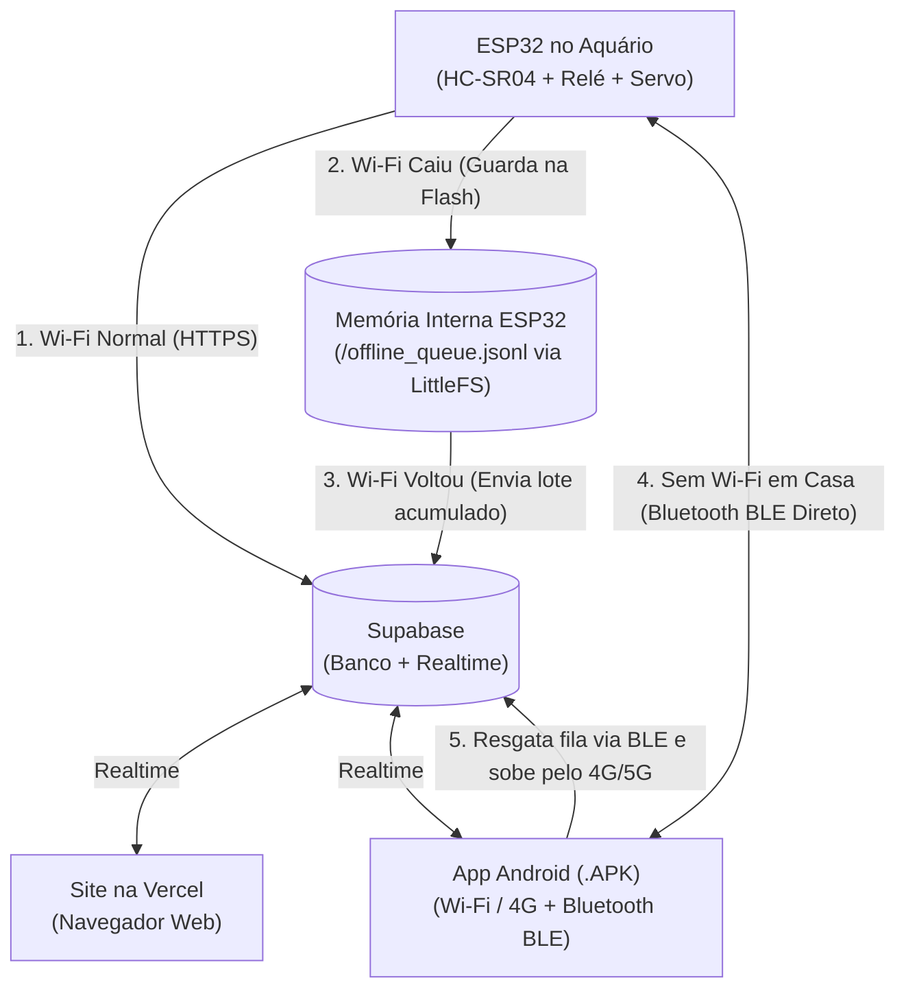

# Documentação de Arquitetura & Planejamento — Projeto NETUNO

Este documento registra todas as decisões de arquitetura, fluxos de comunicação (Online, Offline e Bluetooth) e especificações técnicas definidas para o ecossistema do aquário inteligente **Netuno**.

---

## 1. Visão Geral dos 4 Pilares do Sistema

| Componente | Tecnologia | Papel no Ecossistema |
| :--- | :--- | :--- |
| **1. Hardware (No Aquário)** | **ESP32** (`C++ / Arduino`) | Lê o sensor ultrassônico (`HC-SR04`), controla o módulo relé da bomba de oxigênio e aciona o servo do alimentador automático. Possui **Wi-Fi**, **Bluetooth Low Energy (BLE)** e **Memória Flash Interna (`LittleFS`)**. |
| **2. Nuvem & Tempo Real** | **Supabase** (`PostgreSQL + Realtime`) | Armazena o estado atual do aquário (`aquarium_status`), os horários de alimentação (`feed_schedules`) e o histórico de leituras/eventos (`telemetry_logs`). Sincroniza o Site e o App em tempo real. |
| **3. Painel Web** | **React + Vite + Tailwind CSS** (Hospedado na **Vercel**) | Interface web completa para monitoramento e controle pelo computador ou navegador mobile, incluindo um simulador interativo do `.APK`. |
| **4. Aplicativo Android (`.APK`)** | **React Native + Expo** (`mobile-app/`) | Aplicativo nativo exclusivo para Android com **Comunicação Híbrida Inteligente**: utiliza **Wi-Fi/Internet (Supabase)** quando normal e chaveia automaticamente para **Bluetooth (BLE)** caso o Wi-Fi do aquário caia. |

---

## 2. Identidade Visual & Paleta de Cores ("Oceano Profundo")

Inspirada na logo oficial do **Netuno** (carpas em estilo xilogravura/porcelana sobre fundo azul cobalto):

* **Azul Cobalto Oficial (Cor da Logo):** `#1A539B`
* **Fundo Oceano Profundo (Background Principal):** `#06101E`
* **Fundo de Cards / Superfícies (`Abyss`):** `#0B1D35` e `#0F2747`
* **Destaques Luminosos / Água (`Cyan`):** `#38BDF8`
* **Tipografia Principal:** `Cinzel` (títulos clássicos serifados), `Inter` (interface) e `JetBrains Mono` (dados técnicos e telemetria).

---

## 3. Como Funciona a Comunicação em Cada Cenário



### Cenário A: Tudo Normal (Wi-Fi do Aquário Funcionando)
1. O **ESP32** mede o nível da água a cada ciclo (4 segundos), envia o status atual para a tabela `aquarium_status` no **Supabase** e verifica se há comandos pendentes (`pump_relay_on`, `feed_now_command`).
2. Tanto o **Site na Vercel** quanto o **`.APK` no Android** recebem os dados em tempo real via *Supabase Realtime*.
3. Qualquer comando enviado pelo usuário (ligar/desligar bomba, alimentar agora ou agendar horário) vai para o Supabase e é executado pelo ESP32 via Wi-Fi.

---

### Cenário B: O Wi-Fi Caiu e Você Está Perto do Aquário (Com o `.APK` no Celular)
1. O **`.APK`** detecta que o ESP32 parou de atualizar o Supabase (ou o usuário toca no botão de conexão) e chaveia automaticamente do modo **Wi-Fi (Supabase)** para o modo **Bluetooth (`BLE Direto no ESP32`)**.
2. Pelo Bluetooth, o celular continua mostrando o nível da água ao vivo e permite ligar/desligar o relé da bomba e acionar o alimentador sem depender de roteador ou internet.
3. **Resgate da Fila Offline:** O `.APK` envia o comando `SYNC_OFFLINE` via Bluetooth para o ESP32, recebe todos os registros que o ESP32 guardou enquanto estava sem Wi-Fi e, usando o **4G/5G do próprio celular**, envia esses registros para o **Supabase** (atualizando inclusive o site na Vercel).

---

### Cenário C: O Wi-Fi Caiu e Você Está Fora de Casa (Longe do Bluetooth)
1. **Autonomia Total do Aquário:** O aquário **não para de funcionar**. Como a lógica roda dentro do chip do ESP32:
   * Os peixes continuam sendo alimentados nos horários programados (o relógio interno do ESP32 continua contando o tempo após a sincronização inicial NTP).
   * O ciclo automático da bomba de oxigênio continua operando normalmente.
   * **Proteção de Emergência:** Se o nível da água cair abaixo de `30%` (nível crítico), o próprio ESP32 desliga o relé da bomba automaticamente para evitar que ela trabalhe a seco e queime.
2. **Gravação na Memória Interna (`LittleFS`):** Enquanto estiver sem Wi-Fi, o ESP32 grava as leituras e eventos no arquivo interno `/offline_queue.jsonl` na memória Flash (que não apaga mesmo se faltar luz).
3. **O que aparece no Celular/Site na rua:** Mostra o aviso de *"ESP32 Offline"* com a última leitura conhecida. Se você deixar algum comando pelo celular na rua, ele fica salvo no Supabase aguardando.
4. **Quando o Wi-Fi da casa voltar (ou você chegar em casa):**
   * Se o Wi-Fi voltar sozinho: o ESP32 reconecta automaticamente, descarrega toda a fila `/offline_queue.jsonl` no Supabase (`flushOfflineQueueToSupabase()`) e limpa a memória interna. O gráfico do site e do `.APK` é preenchido sem perder nenhum dado.
   * Se você chegar em casa e o Wi-Fi ainda estiver fora: seu celular conecta via Bluetooth no ESP32 e resgata tudo na hora.

---

## 4. Pinagem de Hardware do ESP32 (`esp32-firmware/netuno_esp32.ino`)

| Periférico | Função no Aquário | Pino no ESP32 | Observações |
| :--- | :--- | :--- | :--- |
| **Sensor Ultrassônico `HC-SR04`** | Medir distância até a lâmina d'água (`cm` e `%`) | `GPIO 5` (`TRIG`) / `GPIO 18` (`ECHO`) | Instalado no topo do aquário apontando para baixo. |
| **Módulo Relé 5V** | Ligar/Desligar Bomba de Oxigênio | `GPIO 26` (`IN`) | Desligamento automático de segurança se nível `< 30%`. |
| **Servo Motor (`SG90` / `MG996R`)** | Dosador do Alimentador Automático | `GPIO 14` (`PWM`) | Tempo de abertura varia conforme porção (`3g`, `5g`, `8g`). |

---

## 5. Estrutura das Tabelas no Supabase (`supabase/schema.sql`)

1. **`public.aquarium_status`** *(1 linha única `id = 1` sempre atualizada)*:
   * `water_level_pct` (`INT`): Percentual atual de água (`0` a `100%`).
   * `distance_cm` (`FLOAT`): Distância medida pelo sensor ultrassônico até a água.
   * `pump_relay_on` (`BOOLEAN`): Estado atual do relé da bomba de oxigênio.
   * `pump_mode` (`TEXT`): `'auto'` ou `'manual'`.
   * `feed_now_command` (`BOOLEAN`): Flag acionada quando o usuário clica em *"Alimentar Agora"*.
   * `feed_now_portion` (`TEXT`): Porção solicitada (`'Leve (3g)'`, `'Padrão (5g)'`, `'Generosa (8g)'`).
   * `esp_last_seen` (`TIMESTAMPTZ`): Último sinal de vida enviado pelo ESP32.

2. **`public.feed_schedules`** *(Horários programados do alimentador)*:
   * `id`, `time` (`'08:00'`), `portion` (`'Padrão (5g)'`), `label` (`'Manhã'`), `enabled` (`true`/`false`).

3. **`public.telemetry_logs`** *(Histórico completo para gráficos e auditoria)*:
   * `id`, `event_type` (`'sensor'`, `'pump'`, `'feeder'`, `'sync'`), `water_level_pct`, `distance_cm`, `message`, `source` (`'ESP32 Wi-Fi'`, `'Fila Offline ESP32'`, `'Bluetooth APK'`, `'Painel Web'`), `recorded_at` *(horário real em que o evento aconteceu no aquário)*.

---

## 6. Comandos Úteis para Desenvolvimento Futuro

### Rodar o Painel Web (e o Simulador do `.APK` no Navegador)
```bash
npm install
npm run dev
# Acesse: http://localhost:5173
```

### Rodar ou Gerar o Instalador `.APK` Android
```bash
cd mobile-app
npm install
npx expo start

# Para compilar o arquivo .APK instalável na nuvem do Expo (EAS):
npm install -g eas-cli
eas login
npm run build:apk
```
