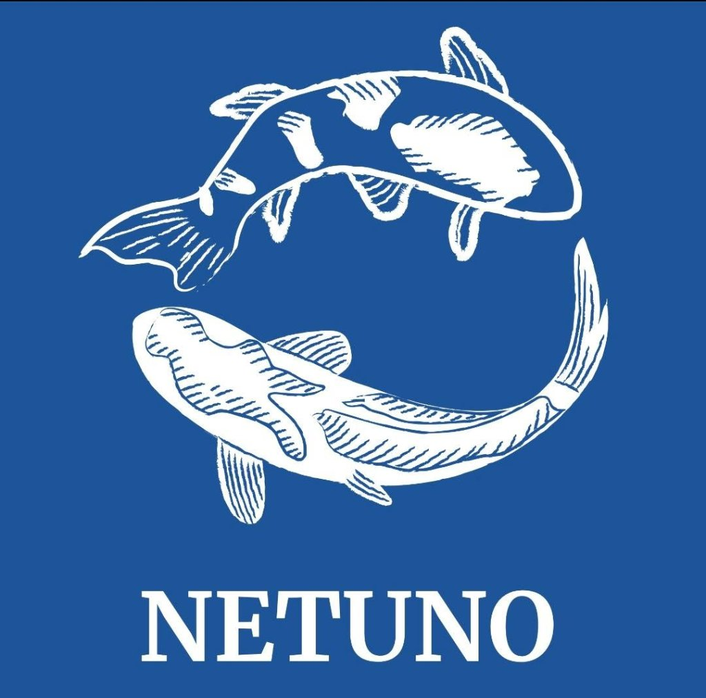

<div align="center">
  
  <h1>NETUNO</h1>
  <p><strong>Sistema de Aquário Inteligente — ESP32 • Supabase • Vercel</strong></p>
</div>

---

## Visão Geral da Arquitetura

O **Netuno** monitora o nível da água (sensor ultrassônico `HC-SR04`) e a temperatura (`DS18B20`), exibe informações no display LCD `16x2`, sincroniza horários com o módulo RTC, controla a bomba de oxigênio e aciona o alimentador automático via **Wi-Fi + Supabase**:

1. **Com Wi-Fi Normal:** O `ESP32` sincroniza leituras e recebe comandos em tempo real pelo **Supabase**, atualizando o **Painel Web (Vercel)**.
2. **Queda de Internet (Fila Offline no ESP32):** Se o Wi-Fi cair, o `ESP32` guarda as leituras na fila offline em memória e envia automaticamente ao Supabase assim que a conexão Wi-Fi retornar.

---

## Estrutura do Repositório

```text
netuno/
├── public/                 # Assets estáticos e logo oficial Netuno
├── src/                    # Painel Web (React + Vite + Tailwind CSS) pronto para Vercel
│   ├── lib/supabase.js     # Cliente Supabase Realtime
│   └── App.jsx             # Interface principal do site
├── netuno_esp32/
│   └── netuno_esp32.ino    # Firmware do ESP32 (HC-SR04 + DS18B20 + LCD + RTC + Multi-WiFi)
└── supabase/
    └── schema.sql          # Script SQL das tabelas e Realtime no Supabase
```

---

## Como Rodar e Publicar Cada Parte

### 1. Site Web (Local & Deploy na Vercel)
```bash
npm install
npm run dev
```
* Para publicar na **Vercel**, basta importar este repositório (`root directory: ./`).
* Quando criar o banco no Supabase, configure as variáveis `VITE_SUPABASE_URL` e `VITE_SUPABASE_ANON_KEY` (veja `.env.example`).

### 2. Banco de Dados (Supabase)
1. Crie um projeto gratuito no [Supabase](https://supabase.com/).
2. Abra o **SQL Editor**, cole o conteúdo de [`supabase/schema.sql`](./supabase/schema.sql) e clique em **Run**.

### 3. Firmware do ESP32
Abra [`netuno_esp32/netuno_esp32.ino`](./netuno_esp32/netuno_esp32.ino) na **Arduino IDE** ou **PlatformIO** e grave na placa ESP32:
* **Display LCD 16x2 I2C (`0x27`) & RTC (`0x68`):** `GPIO 21` (`SDA`) e `GPIO 22` (`SCL`)
* **Sensor Ultrassônico (`HC-SR04`):** `GPIO 5` (`TRIG`) e `GPIO 18` (`ECHO`)
* **Sensor de Temperatura (`DS18B20`):** `GPIO 15` (`OneWire`)
* **Alimentador Automático (Servo / Motor):** `GPIO 13`
