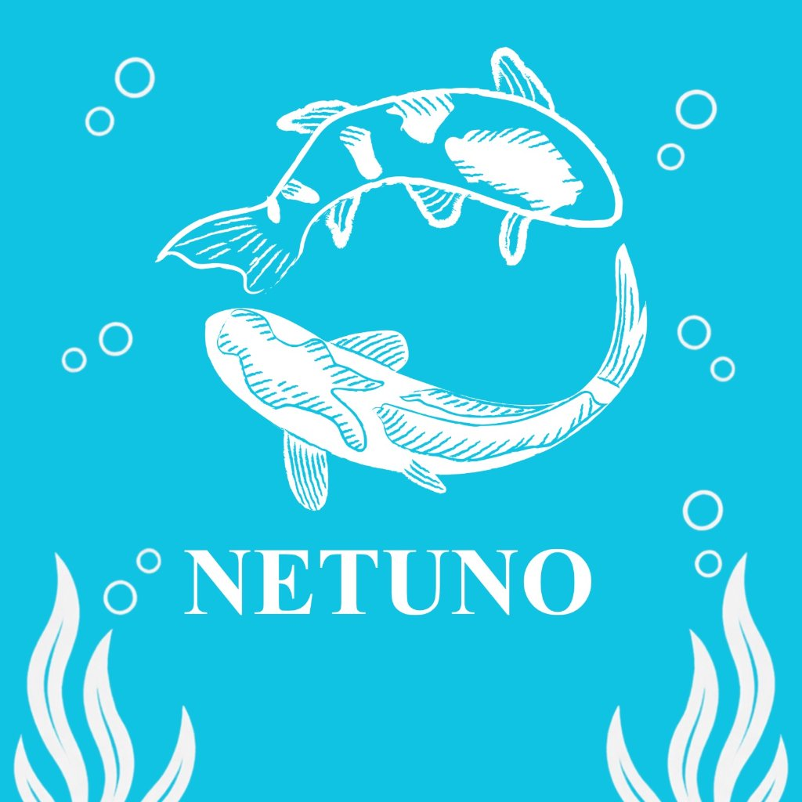

<div align="center">
  
  <h1>NETUNO</h1>
  <p><strong>Aquário Inteligente • ESP32 + Supabase Realtime + React</strong></p>
</div>

---

## Funcionalidades

- **Monitoramento em tempo real:** nível/volume da água (`HC-SR04`) e temperatura (`DS18B20`).
- **Alimentador automático (36g):** carrossel de 12 doses de `3g`, disparo manual ou agendado, controle de estoque e alerta de reabastecimento.
- **Bomba de oxigênio:** modo automático ou acionamento manual pelo painel.
- **Hardware autônomo:** display LCD `16x2`, relógio `RTC DS3231` (backup offline + NTP `-03:00`) e fila local caso o Wi-Fi caia.
- **Painel Web responsivo:** interface para celular, tablet e PC com sincronização instantânea e login por dispositivo.

---

## Pinagem (ESP32)

| Módulo | Pinos no ESP32 |
| :--- | :--- |
| Display LCD `16x2` (`0x27`) + RTC `DS3231` (`0x68`) | `GPIO 21` (SDA), `GPIO 22` (SCL) |
| Sensor Ultrassônico `HC-SR04` | `GPIO 5` (TRIG), `GPIO 18` (ECHO) |
| Sensor de Temperatura `DS18B20` | `GPIO 15` (OneWire) |
| Bomba de Oxigênio (Relé) | `GPIO 23` |
| Motor de Passo `28BYJ-48` (`ULN2003`) | `GPIO 12` (IN1), `GPIO 13` (IN2), `GPIO 14` (IN3), `GPIO 27` (IN4) |

---

## Estrutura

```text
netuno/
├── netuno_esp32/netuno_esp32.ino  # Firmware principal do ESP32
├── alimentador/alimentador.ino    # Sketch isolado de teste do alimentador
├── supabase/schema.sql            # Tabelas, políticas RLS e Realtime
└── src/                           # Painel Web (React + Vite + Tailwind CSS)
```

---

## Configuração Rápida

### 1. Supabase
Crie um projeto no [Supabase](https://supabase.com/) e execute [`supabase/schema.sql`](./supabase/schema.sql) no **SQL Editor**.

### 2. Painel Web (Local / Vercel)
Configure `VITE_SUPABASE_URL` e `VITE_SUPABASE_ANON_KEY` (veja [`.env.example`](./.env.example)) e rode:

```bash
npm install
npm run dev
```

Na **Vercel**, importe o repositório com as mesmas variáveis de ambiente.

### 3. ESP32
1. Grave [`netuno_esp32/netuno_esp32.ino`](./netuno_esp32/netuno_esp32.ino) no ESP32 pela **Arduino IDE** ou **PlatformIO**.
2. No primeiro uso, conecte-se à rede Wi-Fi **`NETUNO-SETUP`** e acesse `http://10.0.0.1` para cadastrar o Wi-Fi e o usuário/senha do aquário.
